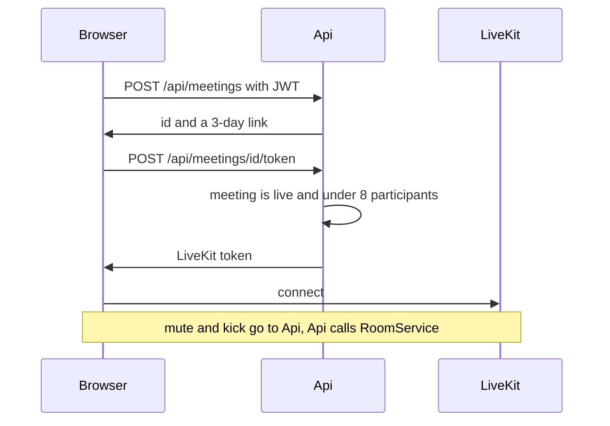

# Iteration 1: LiveKit meetings

Status: specs 01–03 are done. Implement one spec at a time, in the order below. Each spec is one commit. When a spec is ready, run its checks and stop for review. Do not commit it, and do not start the next spec, until the user has reviewed it and explicitly approved moving on.

Out of scope: recording, persisted chat, P2P without LiveKit, an AI agent participant, a waiting room, meeting passwords, mobile layout.

## Stack

Keep the existing NestJS 12 backend, React Router 7 frontend, and Prisma Next on Postgres. Do not adopt Better Auth or Clerk.

Better Auth's official adapter expects the classic Prisma Client, not `@prisma/orm-postgres` and [backend/src/prisma/contract.prisma](../../backend/src/prisma/contract.prisma). Clerk would move users to a vendor even though guests join without an account and `User` already lives in Postgres.

The "do not hand-roll auth" rule in [AGENTS.md](../../AGENTS.md) is met with libraries, not a stack change:

- Passwords stay on `bcrypt`. Tokens stay on `@nestjs/jwt`.
- Replace the hand-written GitHub `fetch` in [backend/src/auth/github-auth.service.ts](../../backend/src/auth/github-auth.service.ts) with Arctic (`arctic`). That avoids a custom OAuth client and the `express-session` dependency that `passport-github2` wants.

Record this, and the room rules below, in `docs/decisions.md`. Fill the Tech stack and Commands sections of [AGENTS.md](../../AGENTS.md) when the meeting API lands (spec 03).

## Room rules

- LiveKit Cloud. `LIVEKIT_API_KEY` and `LIVEKIT_API_SECRET` live only in `backend/.env`. The browser receives the public WebSocket URL and a short-lived room token.
- Only a signed-in user can create a meeting. Anyone with the link can join after entering a display name. A signed-in user joins under their account name.
- Link shape: `{FRONTEND_URL}/m/{id}`. `id` is 128 random bits, `base64url`, never a sequence.
- A meeting lasts 3 days from creation. After `expiresAt`, delete the database row and the LiveKit room. Do not issue another token.
- LiveKit closes an empty room after `emptyTimeout` of 5 minutes. The same link can open a new LiveKit room within the 3 days. Chat from the previous session is gone.
- At most 8 participants. Reconnecting an identity that is already in the room does not take a new seat.
- The creator can mute another participant's microphone and remove them. Everyone else is equal. The client token has no `roomAdmin` grant. Mute and remove run on the server with the LiveKit secret, and only when the JWT user is `hostId`.
- A screen share takes the main area immediately. If several shares are active, the most recently published one is main. When sharing stops, the main tile falls back to speaker selection.
- `selectMainSpeaker` holds the previous camera tile for 1.2 seconds before switching to a new loudest speaker. Silence does not clear the last main tile. Screen share bypasses the hold.
- Chat uses `useChat` from `@livekit/components-react` (LiveKit text channel). Do not write messages to Postgres.
- Browsers for this iteration: current desktop Chrome, Edge, Firefox, and Safari.

The home-page "call by email" block is the later P2P mode. Replace it with a paste-a-link field. Do not build the agent.

## Specs

1. [Finish backend auth](../../docs/specs/01-auth-backend.md)
2. [Wire frontend auth](../../docs/specs/02-auth-frontend.md)
3. [Meetings API](../../docs/specs/03-meetings-backend.md)
4. [Home and join](../../docs/specs/04-home-and-join.md)
5. [Meeting room](../../docs/specs/05-meeting-room.md)
6. [Chat](../../docs/specs/06-chat.md)
7. [Host moderation API](../../docs/specs/07-moderation-backend.md)
8. [Host controls](../../docs/specs/08-host-controls.md)

## Verification

- Spec 03: Jest for id shape, expiry, and the 8-person cap. Spec 07: Jest for the host check.
- Spec 05: Vitest for `selectMainSpeaker`.
- Manual, two desktop browsers, as each spec lands: email and GitHub sign-in, guest join, speaker switch, screen share in the main area, microphone and camera selection, chat gone after everyone leaves, mute and kick, a link older than 3 days, a ninth participant. Do not test mobile.
- Playwright with fake media devices is not part of this iteration. Two real browsers and screen share are not covered by that setup.
